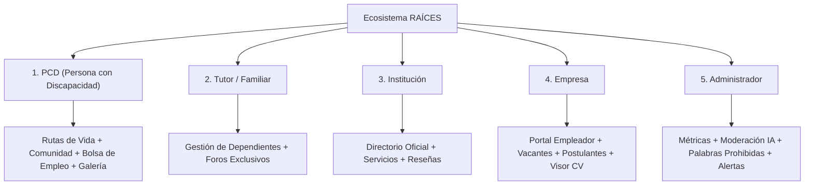

# GUÍA MAESTRA DE PRUEBAS QA — SISTEMA RAÍCES (ENTREGA FINAL)

> **Documento de Auditoría y Verificación Exhaustiva para QA**  
> **Plataforma:** RAÍCES (Ecosistema Integral de Inclusión Social, Educativa y Laboral)  
> **Versión del Sistema:** Release Candidata v2.0  

---

## 1. Contexto Global: ¿Qué es RAÍCES?

**RAÍCES** es un ecosistema digital integral diseñado para derribar las barreras de exclusión que enfrentan las **Personas con Discapacidad (PCD)** y sus familias en México. 

La plataforma articula en un único entorno coordinado a **5 actores clave**:
1. Las personas con discapacidad (usuarios autónomos).
2. Sus familias y tutores de apoyo.
3. Las instituciones educativas, clínicas y asistenciales (CAM, USAER, DIF, ONGs, centros de terapia).
4. El sector productivo y laboral (empresas comprometidas con la inclusión y adaptaciones de puesto).
5. El equipo de administración y supervisión del ecosistema.

### Arquitectura Técnica
- **Frontend (`raices-frontend`):** React 18, TypeScript, Vite, React Router 6, TanStack Query (React Query), Zustand / Context API para estados globales, Lucide Icons y animaciones optimizadas para accesibilidad.
- **Backend (`raices-backend`):** NestJS, TypeScript, Firebase Admin SDK (Firestore Database, Firebase Auth, Firebase Storage), motor de IA Gemini 3.x con thinking minimal para moderación y análisis de necesidades, y motor de auditoría centralizado.
- **Accesibilidad Universal (A11y):** Diseñado bajo lineamientos WCAG 2.1 AA (navegación por teclado, contraste alto, lectura fácil, modo oscuro, fuentes adaptadas para dislexia y soporte de lectores de pantalla).

---

## 2. Mapa de los 5 Roles del Sistema

Cada rol tiene permisos, rutas protegidas y experiencias visuales distintas:

---

## 3. Matriz de Pruebas por Módulo y Funcionalidad

---

### MÓDULO 1: Autenticación, Registro y Verificación de Identidad

#### ¿Qué hace?
Permite el ingreso mediante Firebase Auth / JWT, selección de rol durante el registro y verificación formal de identidad (CURP para personas físicas, validaciones OCR).

#### Checklist de Pruebas para QA:
1. **Registro e Inicio de Sesión:**
   - Registrarse como PCD, Tutor, Empresa e Institución.
   - Probar credenciales incorrectas (debe mostrar feedback visual claro).
   - Comprobar opción "Recordarme" (almacena token en `localStorage` vs `sessionStorage`).
2. **Onboarding Guiado:**
   - Para PCD: Diagnóstico inicial de necesidades (educativas, motrices, sensoriales, laborales).
   - Validar que al completar el onboarding, el feed personalice los servicios sugeridos.
3. **Verificación de Identidad (`/verificacion-identidad`):**
   - Validar formato de CURP (18 caracteres con algoritmo de dígito verificador).
   - Si un usuario con rol `empresa` entra aquí, el sistema debe redirigirlo automáticamente a su panel (persona moral no usa CURP).

---

### MÓDULO 2: Red Social y Comunidad ("Conectemos") (`/social`)

#### ¿Qué hace?
Espacio de interacción social segura dividido en 5 pestañas:
1. **Publicaciones:** Feed comunitario con publicaciones de texto e imagen, likes y comentarios anidados.
2. **Grupos:** Comunidades temáticas con opción de publicar exclusivamente para padres/tutores.
3. **Galería Conectemos:** Muro de exhibición visual para arte y experiencias.
4. **Eventos:** Cartelera de talleres, actividades accesibles y confirmación de asistencia.
5. **Acerca de la comunidad:** Normas de convivencia inclusiva.

#### Categorías Creativas:
- `General`: Charlas cotidianas, dudas o avisos.
- `Arte`: Dibujos, pinturas, esculturas o manualidades.
- `Experiencias`: Vivencias, testimonios, logros y aprendizajes personales.

#### Pruebas Críticas para QA:
1. **Filtros del Feed:**
   - Probar los botones `[Todas]`, `[General]`, `[Arte]` y `[Experiencias]`.
   - Verificar que al filtrar por `Experiencias`, aparezcan tanto posts recientes como históricos.
2. **Galería Conectemos:**
   - **Regla del Muro:** La Galería **solo** admite publicaciones con **archivo gráfico o video adjunto**. Las publicaciones de solo texto no deben entrar a la cuadrícula.
   - Probar los estados vacíos: Si una categoría no tiene obras, debe mostrar el banner explicativo con el botón directo de acción:
     - `[ + Compartir obra de arte ]`
     - `[ + Compartir una experiencia ]`
   - Subir una publicación con imagen bajo la categoría *Arte* y comprobar que aparece de inmediato en la Galería.
3. **Moderación Automática con IA (Gemini):**
   - **Caso Positivo:** Publicar *"Hoy logramos un avance increíble en la terapia física con la silla adaptada."* → Se aprueba inmediatamente y aparece en el feed.
   - **Caso Negativo (Grosería / Capacitismo):** Escribir una ofensa o frase capacitista → La publicación **no** sale en el feed; salta el modal `ModeracionFeedbackModal` con el motivo, la causa y una **sugerencia constructiva en Lectura Fácil** con botón para editar y corregir.
   - **Caso Negativo (Spam / Finanzas):** Escribir *"Gana dinero fácil compartiendo esta cadena a 10 personas"* → Se retiene por Spam y va a la cola de moderación del administrador.
4. **Eventos Inclusivos:**
   - Filtrar eventos por fecha, presencial/virtual y marcar asistencia (Toggle "Asistiré").

---

### MÓDULO 3: Bolsa de Trabajo Inclusiva y Portal de Empresa (`/empresa`, `/jobs`)

#### ¿Qué hace?
Conecta a personas con discapacidad con vacantes que garantizan adaptaciones ergonómicas, rampas, software de lectura o flexibilidad. Las empresas gestionan postulantes y evalúan sus CVs.

#### Checklist de Pruebas para QA:
1. **Portal de Empresa (`/empresa/dashboard`):**
   - **Crear y Publicar Vacante:** Llenar título, sueldo, adaptaciones requeridas (ej. rampa, elevador, intérprete LSM) y tipo de jornada.
   - **Pestaña "Postulantes":**
     - Ver lista de candidatos inscritos.
     - Botón de cambio de estado: `Pendiente`, `Aceptar`, `Rechazar`.
     - **Visualización de CV (Columna CV):**
       - Hacer clic en `[ 📄 Ver CV ]`: Debe abrir el modal interactivo `CvModal` con zoom (`-`, `100%`, `+`), visor A4 y botón directo de `Imprimir`.
       - **Prueba Anti-Regresión:** Asegurar que **no** aparezca el error `ERR_BLOCKED_BY_CSP`.
       - Hacer clic en `[ 📥 ]`: Debe descargar el PDF original o estructurado del postulante.
     - **Detalle de Candidato (`PerfilPostulanteModal`):**
       - Abrir "Ver perfil" de un candidato. Comprobar que en la parte inferior aparece la sección *"Currículum Vitae (CV)"* con sus botones de ver y descargar.
2. **Vista de Candidato (`/jobs`):**
   - Explorar vacantes disponibles y filtrar por adaptaciones.
   - Postularse a una vacante adjuntando carta de presentación y un archivo PDF de CV.
   - Comprobar que la vista previa del archivo subido en `ApplicationModal` sea nítida y segura.

---

### MÓDULO 4: Directorio de Instituciones y Reseñas (`/explore`, `/institution/:id`)

#### ¿Qué hace?
Catálogo geolocalizado de centros de atención, escuelas especiales (CAM/USAER) y clínicas de rehabilitación.

#### Checklist de Pruebas para QA:
1. **Búsqueda y Filtros:**
   - Búsqueda por texto (nombre, especialidad, terapia).
   - Filtro por Código Postal (CP) mexicano o español (utiliza `postalCodeLookup`).
   - Filtro por tipo de servicio (Educación, Salud, Rehabilitación, Legal).
2. **Ficha de Institución:**
   - Verificar mapa/dirección, horarios y servicios activos.
   - Dejar una reseña con calificación por estrellas y comentario.
   - Verificar insignias de acreditación oficial ("Institución Verificada").

---

### MÓDULO 5: Panel de Administración Integral (`/admin`)

#### ¿Qué hace?
Centro de mando para supervisar la salud del ecosistema, resolver alertas de inteligencia y moderar contenido.

#### Pestañas a Probar:
1. **Resumen (`overview`):**
   - Métricas en tarjetas (Usuarios, Publicaciones, Instituciones, Reseñas).
   - Gráfica interactiva con alternancia entre `Barras` y `Área`.
   - Gráfica de `Distribución` relativa del ecosistema.
2. **Gestión de Instituciones (`institutions`):**
   - Lista de instituciones pendientes de aprobación o verificación.
   - Acciones: Aprobar o Rechazar con feedback.
3. **Gestión de Usuarios (`users`):**
   - Paginación dinámica y buscador en tiempo real por nombre, correo y rol.
   - Activar / suspender cuentas.
4. **Moderación de Publicaciones (`moderacion`):**
   - **Cola de Revisión:** Publicaciones retenidas automáticamente por la IA.
   - El admin puede revisar el texto original, la causa dada por la IA y presionar **Aprobar** (hace visible el post en el feed) o **Confirmar Rechazo**.
   - **Diccionario de Palabras Prohibidas:**
     - Buscar términos con el nuevo filtro de texto, categoría y estado (activas/inactivas).
     - Agregar nueva palabra prohibida y verificar que el motor de respaldo la tome en cuenta inmediatamente.
5. **Alertas de Riesgo (`alerts`):**
   - Visualización de alertas automáticas (ej. alta concentración de reportes o brecha crítica entre demanda y oferta institucional).
   - Resolver alertas con botón de acción directa.

---

### MÓDULO 6: Sistema de Notificaciones y Navegación

#### ¿Qué hace?
Campana superior (`TopNav`) y Centro de Notificaciones (`/notifications`) con redirección contextual inmediata.

#### Checklist de Pruebas para QA:
1. **Campana Superior (`TopNav`):**
   - Badge numérico en rojo (`1`, `2`, `9+`) cuando existan notificaciones no leídas.
   - Si el usuario es **Admin**, debe mostrar las alertas de riesgo y tareas pendientes inyectadas dinámicamente.
2. **Navegación al hacer Clic:**
   - Al hacer clic sobre cualquier notificación en el menú desplegable:
     - Si es una alerta de admin → Lo lleva directo a `/admin?tab=alerts`.
     - Si son tareas pendientes de instituciones → Lo lleva a `/admin?tab=institutions`.
     - Si es una publicación rechazada por moderación → Lo lleva a `/admin?tab=moderacion`.
     - Si es un evento → Lo lleva a `/social?tab=eventos`.
     - Si es una postulación laboral → Lo lleva a `/empresa/dashboard` (si es empresa) o `/jobs` (si es candidato).
3. **Página de Notificaciones (`/notifications`):**
   - Segmentos: `Todas`, `No leídas`, `Inteligencia`, `Riesgos`.
   - Botón *"Marcar todas como leídas"*.
   - Hacer clic en la tarjeta o en el enlace `Ir a la sección →`: Debe marcar la notificación como leída y navegar a la vista de destino.

---

### MÓDULO 7: Accesibilidad Universal (Barra A11y)

#### Checklist de Pruebas para QA:
1. **Barra de Accesibilidad (inferior/lateral):**
   - **Tamaño de texto:** Aumentar fuente (+A) y reducir (-A) — toda la interfaz debe escalar sin encimarse.
   - **Alto Contraste:** Activar modo de alto contraste y verificar legibilidad de textos sobre fondos oscuros y claros.
   - **Fuente para Dislexia:** Alternar fuente `OpenDyslexic` y verificar que los párrafos adopten la tipografía adaptada.
   - **Reducción de movimiento:** Desactivar animaciones y transiciones en la plataforma.
   - **Modo Claro / Modo Oscuro:** Probar toggle con icono en la barra superior.

---

## 4. Matriz Rápida de Credenciales de Prueba

Para ejecutar las pruebas en local, QA puede utilizar las siguientes cuentas semilla o registrar usuarios con cada rol:

| Rol | Correo Sugerido | Propósito de Prueba |
|---|---|---|
| **PCD** | `usuario.pcd@raices.mx` | Onboarding, rutas, muro social, galería de arte y postulación laboral con CV. |
| **Tutor** | `familiar.tutor@raices.mx` | Administración de dependientes y foros de padres. |
| **Empresa** | `empresa.ejemplo@raices.mx` | Creación de vacantes inclusivas y evaluación de CVs de postulantes. |
| **Institución** | `institucion.test@raices.mx` | Gestión de servicios, publicación de eventos y recepción de reseñas. |
| **Admin** | `admin@raices.mx` | Dashboard global, alertas de riesgo, moderación IA y gestión de usuarios. |

---

## 5. Criterios de Aceptación para Entrega Final (Go / No-Go)

- [x] **Compilación Limpia:** 0 errores de TypeScript (`pnpm exec tsc --noEmit`).
- [x] **Batería de Pruebas Unitarias:** 33 suites y 521 tests en verde (`pnpm test -- --run`).
- [x] **Políticas de Seguridad y CSP:** Carga de PDFs y CVs sin bloqueos `ERR_BLOCKED_BY_CSP`.
- [x] **Flujo de Moderación IA:** Prevención activa de contenido dañino con explicación educativa en Lectura Fácil.
- [x] **Sincronización Git:** Frontend y Backend sincronizados en la rama `main` sin conflictos.
